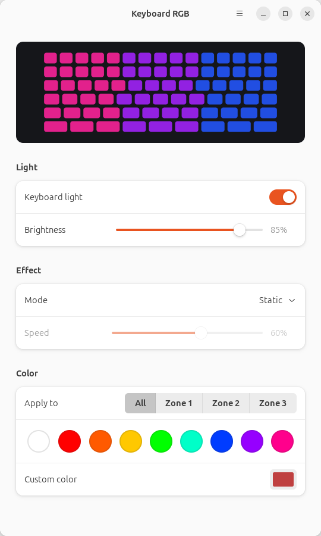

# now-i-can-use-my-keyboard-in-the-dark-while-i-use-linux

**Because apparently, Linux users need RGB too.**

A Linux replacement for the Windows Control Center, bringing RGB keyboard lighting control to supported Avell/Clevo laptops.

The app is called **Keyboard RGB**. The package is `my-keyboard-app` and the command is `avell-kbd`.



*The settings window, rendered by the app. For this screenshot it was driven by a simulated 3-zone keyboard so the per-zone controls are visible; on a 1-zone keyboard the "Apply to" row is hidden.*

> 📸 **Screenshot of the tray menu: TODO.** 🎞️ **Demo GIF: TODO.** Contributions welcome.

---

## Contents

- [Features](#features)
- [Compatibility](#compatibility)
- [Install](#install)
- [Usage](#usage)
- [Uninstall](#uninstall)
- [Troubleshooting](#troubleshooting)
- [How it works](#how-it-works)
- [Development](#development)
- [Contributing](#contributing)
- [License](#license)

## Features

- **Tray icon** in the top bar, drawn in the keyboard's current color:
  - click: quick menu (on/off, effect, color, brightness, settings)
  - scroll over the icon: brightness (5% steps)
  - middle click: on/off
- **Global shortcut** to toggle the light, **Ctrl+Super+K** by default (Super is the key with the Windows logo). It's shown next to "On" in the tray menu. It's a regular GNOME custom shortcut, so you can change or delete it in *Settings → Keyboard → Keyboard Shortcuts*.
- **Settings window** with a live preview, brightness, effect and speed, preset and custom colors, and per-zone colors on 3-zone keyboards.
- **Effects**: Static, Breathing, Color cycle, Rainbow wave and Flash. On a 1-zone keyboard, Rainbow wave looks the same as Color cycle. White-only keyboards support static light only, and the app disables the effect and color controls for them.
- **Restores your settings** when you log in and after suspend.
- **Follows external brightness changes**: when something else changes the backlight brightness (for example GNOME, or the Fn keys if the driver reports them), the app adopts the new value instead of fighting it.
- **Reports problems** instead of failing silently: the window and the tray say when no supported keyboard is found, when permissions are missing, when the background service isn't running, or when writes to the keyboard fail.

## Compatibility

### Tested on real hardware

| Laptop | Keyboard | Distribution | Kernel | Desktop | Driver | Result |
|---|---|---|---|---|---|---|
| Avell High Performance A57 (Intel i7-11800H) | RGB, 1 zone | Ubuntu 24.04.5 LTS | 7.0.0-43-generic | GNOME (Ubuntu), X11 | tuxedo-drivers `76b226b`, manual install | 13/13 checks of [`check_real_hardware.py`](tests/hardware/check_real_hardware.py) passed |

That is the **only** configuration that has been tested on real hardware so far. On that laptop, these have **not** been verified yet:
- the physical Fn brightness keys (the check simulates an external brightness change instead);
- restoring the colors after a real suspend/resume (the logic is unit-tested with a simulated clock);
- installing the `.deb` (it was tested in CI; the laptop used the manual install).

### Tested without hardware

- **CI** (GitHub Actions, Ubuntu 24.04): the `.deb` installs, the driver compiles with DKMS against the runner's kernel, the package removes cleanly, and the full test suite passes with a simulated keyboard.
- **Simulated hardware** (unit tests): 3-zone RGB keyboards, white-only keyboards, missing or vanished devices, permission errors and invalid sysfs values.

### Theoretical (untested, reports welcome)

- **Other Clevo-based laptops** whose keyboard is driven by the `tuxedo_keyboard` module (from tuxedo-drivers). This includes other Avell models and other brands built on Clevo chassis. Whether a given model works depends on the driver, not on this app.
- **3-zone RGB and white-only Clevo keyboards.** The code paths exist and are tested with simulated devices only.
- **Wayland sessions, other GNOME versions, and other desktops** with a StatusNotifierItem tray (e.g. KDE Plasma). On desktops without GNOME settings, the global shortcut isn't created; everything else should work.
- **Other Debian/Ubuntu releases** with GTK ≥ 4.10 and libadwaita ≥ 1.4 (Ubuntu 24.04 or newer). Ubuntu 22.04 is too old.

### Not supported

- Keyboards that are not exposed by the `tuxedo_keyboard` driver. The app deliberately ignores keyboard LEDs from other drivers (Dell, ASUS, Lenovo…).
- Per-key RGB keyboards (ITE controllers, driven by other tuxedo-drivers modules), and hardware/firmware effects. All effects are rendered in software by the app.
- Non-Debian distributions with the provided scripts. The app itself is plain Python, but `install-driver.sh` and the `.deb` assume apt.

### Requirements

- Linux with DKMS and the headers for your kernel (the driver is built locally).
- The Clevo keyboard modules from [tuxedo-drivers](https://github.com/tuxedocomputers/tuxedo-drivers). The `.deb` and `install-driver.sh` build them for you.
- Python 3.10+, PyGObject, GTK ≥ 4.10 and libadwaita ≥ 1.4.
- For the tray icon on GNOME: the AppIndicator extension, which Ubuntu ships enabled.

### Report your laptop

Run the hardware check and open a [compatibility report](../../issues/new?template=compatibility_report.md) with its output, whether it worked or not:

```bash
git clone https://github.com/carlosxjm/now-i-can-use-my-keyboard-in-the-dark-while-i-use-linux.git
cd now-i-can-use-my-keyboard-in-the-dark-while-i-use-linux
./tests/hardware/check_real_hardware.py --yes --stop-service
```

It changes your keyboard's colors for about 15 seconds and then restores them. It doesn't touch your settings.

## Install

### Option 1: .deb package (recommended)

Download `my-keyboard-app_*_all.deb` from the [latest release](../../releases/latest) and run:

```bash
sudo apt install ./my-keyboard-app_*_all.deb
```

apt installs the dependencies, builds the driver with DKMS (so it is rebuilt automatically on kernel updates) and installs the udev rule and the user service. Log out and back in to get the tray icon.

If you used the manual install before, run `./uninstall.sh` first, so your old user service doesn't take precedence over the packaged one.

### Option 2: manual install (from source)

```bash
git clone https://github.com/carlosxjm/now-i-can-use-my-keyboard-in-the-dark-while-i-use-linux.git
cd now-i-can-use-my-keyboard-in-the-dark-while-i-use-linux
sudo ./install-driver.sh   # once: driver (DKMS) + udev rule
./install.sh               # the app, for your user (no sudo)
```

Both scripts are safe to run again, for example to upgrade.

### What gets installed

| What | .deb | Manual install |
|---|---|---|
| Driver sources (Clevo modules from tuxedo-drivers, pinned in [`packaging/tuxedo-drivers.ref`](packaging/tuxedo-drivers.ref)) | `/usr/src/my-keyboard-app-<version>/` + DKMS | `/usr/src/my-keyboard-app-src.<commit>/` + DKMS |
| udev rule (see [SECURITY.md](SECURITY.md)) | `/usr/lib/udev/rules.d/99-my-keyboard-app.rules` | `/etc/udev/rules.d/99-my-keyboard-app.rules` |
| Load `clevo_acpi` at boot | `/usr/lib/modules-load.d/my-keyboard-app.conf` | `/etc/modules-load.d/my-keyboard-app.conf` |
| App | `/usr/lib/my-keyboard-app/`, `/usr/bin/avell-kbd` | `~/.local/lib/my-keyboard-app/`, `~/.local/bin/avell-kbd` |
| Menu entry | `/usr/share/applications/io.github.carlosxjm.KeyboardRGB.desktop` | `~/.local/share/applications/…` |
| Tray/effects service (systemd user unit) | `/usr/lib/systemd/user/avell-kbd.service`, enabled for all users | `~/.config/systemd/user/avell-kbd.service` |
| GNOME shortcut (created by the service on first start) | dconf: `…/custom-keybindings/my-keyboard-app/` | same |
| Your settings | `~/.config/avell-kbd/config.json` | same |

## Usage

- **Tray icon**: click for the menu, scroll to change brightness, middle-click to toggle.
- **Ctrl+Super+K**: toggle the light from anywhere.
- **Settings window**: *Settings…* in the tray menu, or **Keyboard RGB** in the app grid.
- **Command line**:

  ```
  avell-kbd             open the settings window
  avell-kbd --toggle    turn the light on/off
  avell-kbd --status    detected hardware, permissions and service state
  avell-kbd --version
  ```

## Uninstall

- **.deb**: `sudo apt remove my-keyboard-app`. This removes the app, the driver, the udev rule and the service. Your settings in `~/.config/avell-kbd` are kept. The GNOME shortcut stays in your settings, pointing to a command that no longer exists; delete it in *Settings → Keyboard*.
- **Manual install**:

  ```bash
  ./uninstall.sh                # app, service, menu entry and GNOME shortcut (no sudo)
  sudo ./uninstall.sh --driver  # driver and udev rule
  ```

  Only files created by this project are removed, and your settings are kept.

## Troubleshooting

Start with `avell-kbd --status`.

**"No supported keyboard found"**
- Check whether the driver is loaded: `lsmod | grep -E 'clevo|tuxedo'`.
- Check whether DKMS built it: `dkms status | grep my-keyboard-app` (it should say `installed` for your kernel).
- If the build failed, the log is at `/var/lib/dkms/my-keyboard-app/<version>/build/make.log`. Please open an issue with it.
- After a kernel update, DKMS rebuilds the driver automatically. If that failed, reinstalling the package (or re-running `sudo ./install-driver.sh`) shows the error.
- With **Secure Boot** enabled, unsigned DKMS modules don't load unless you enroll a MOK key (`sudo mokutil --import /var/lib/shim-signed/mok/MOK.der`, then reboot).
- Your laptop may simply not be supported by `tuxedo_keyboard`; see [Compatibility](#compatibility).

**"No permission to control the keyboard"**
- The udev rule is missing or wasn't applied. Re-run `sudo ./install-driver.sh` (or reinstall the .deb), or reboot.

**"The background service isn't running"**
- `systemctl --user status avell-kbd` and `journalctl --user -u avell-kbd -b` show what happened.
- `systemctl --user restart avell-kbd` restarts it. *Quit* in the tray menu stops it until your next login.

**No tray icon**
- On GNOME, the AppIndicator extension must be enabled: `gnome-extensions list --enabled | grep -i appindicator`.

**The shortcut doesn't work**
- Look for "Keyboard RGB: toggle light" in *Settings → Keyboard → Keyboard Shortcuts → Custom Shortcuts*. If you deleted it, the app won't recreate it; add a custom shortcut that runs `avell-kbd --toggle`.

**The keyboard goes back to the firmware default before login**
- That's expected: the service runs in your graphical session, so your colors are applied when you log in.

## How it works

```
 settings window ──┐                       ┌── tray icon (D-Bus: StatusNotifierItem + DBusMenu)
 avell-kbd --toggle ├─► ~/.config/avell-kbd/config.json ─► daemon ─┤
 tray menu ─────────┘   (locked, atomic, validated)       │        └── $XDG_RUNTIME_DIR/avell-kbd/status.json ─► settings window
                                                          ▼
                                    /sys/class/leds/rgb:kbd_backlight*/{brightness,multi_intensity}
                                                          ▼
                                     tuxedo_keyboard + clevo_acpi (tuxedo-drivers, DKMS) ─► Clevo firmware
```

- The **daemon** (`avell-kbd --daemon`, systemd user service) is the only process that writes to the keyboard. It applies the config, renders the effects at 20 fps (about 2% of one CPU core measured on the A57), adopts external brightness changes and publishes its status.
- Everything else only edits the config file. Each writer changes just the keys it touched, under a file lock, so writers never overwrite each other's changes.
- Hardware access lives in [`keyboard_rgb/hardware.py`](keyboard_rgb/hardware.py) behind a small backend interface. Today there is one backend (Clevo via `tuxedo_keyboard`); a new laptop family would get its own backend class.

## Development

```bash
sudo apt install python3-gi gir1.2-gtk-4.0 gir1.2-adw-1 xvfb   # xvfb: optional, for GUI tests
./bin/avell-kbd                 # run from the checkout (window)
./bin/avell-kbd --daemon -v     # daemon with debug logs (stop the installed service first)
```

Point the app at a fake keyboard, with no laptop needed:

```bash
export KEYBOARD_RGB_SYSFS=/tmp/fake-leds   # directory laid out like /sys/class/leds
```

See `tests/helpers.py` (`FakeLeds`) for how a fake device is built.

### Tests

```bash
./tests/run.sh        # whole suite with mocked hardware, on a private D-Bus bus (and Xvfb if installed)
./tests/run.sh -v     # verbose
```

The suite covers config validation and concurrency, effects, the hardware backend (missing, vanished or invalid devices, permissions, channel order), the daemon loop, the tray menu and its D-Bus API (including invalid calls), the GNOME shortcut, the CLI, the install/uninstall scripts, and settings window smoke tests. It never touches your real keyboard, settings or desktop session.

[`tests/hardware/check_real_hardware.py`](tests/hardware/check_real_hardware.py) is the separate, opt-in check for a real laptop.

CI ([`.github/workflows/ci.yml`](.github/workflows/ci.yml)) runs shellcheck, desktop-file and udev rule validation, a version check and the test suite on every push and pull request. It then builds the `.deb` and test-installs it. Tags `vX.Y.Z` publish a GitHub release.

### Building the package

```bash
./packaging/build-deb.sh      # -> dist/my-keyboard-app_<version>_all.deb
```

## Contributing

Bug reports, compatibility reports (working *and* non-working laptops), screenshots and pull requests are welcome. See [CONTRIBUTING.md](CONTRIBUTING.md). Report security issues as described in [SECURITY.md](SECURITY.md).

## License

GPL-2.0-or-later; see [LICENSE](LICENSE). The bundled driver sources come from [tuxedo-drivers](https://github.com/tuxedocomputers/tuxedo-drivers) (© TUXEDO Computers GmbH, GPL-2.0-or-later). This project is not affiliated with Avell, Clevo or TUXEDO Computers.
